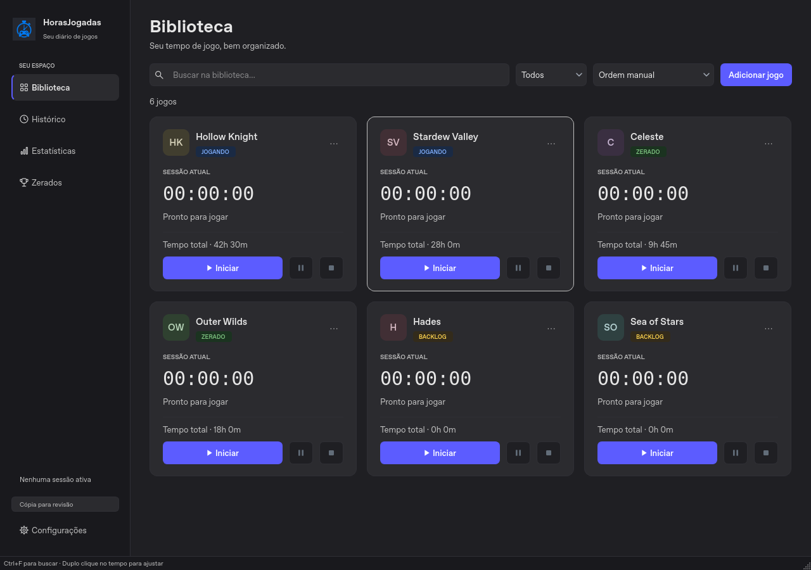

<div align="center">

# HorasJogadas

**Cada partida conta. Guarde a sua história.**

Cronômetros, biblioteca, histórico, estatísticas e jogos zerados. Interface em português e inglês, com dados no seu computador.

[**Baixar o aplicativo**](https://joaoppolli.github.io/HorasJogadas/) · [Todos os downloads](https://github.com/JoaoPPolli/HorasJogadas/releases/latest) · [Guia de uso](docs/GUIA_DE_USO.md)

</div>



## Instalar

**Windows 10/11 de 64 bits:** [baixe o instalador](https://github.com/JoaoPPolli/HorasJogadas/releases/latest/download/HorasJogadas-Windows-Setup.exe), abra e siga as instruções. O app aparece no menu Iniciar. Não precisa instalar Python nem executar como administrador.

Prefere sem instalação? [Baixe o ZIP portátil](https://github.com/JoaoPPolli/HorasJogadas/releases/latest/download/HorasJogadas-Windows-Portable.zip), extraia **a pasta inteira** e abra `HorasJogadas.exe` dentro dela.

**Linux x86_64, Ubuntu 22.04 ou compatível:** [baixe o pacote](https://github.com/JoaoPPolli/HorasJogadas/releases/latest/download/HorasJogadas-Linux-x86_64.tar.gz), extraia e execute `./HorasJogadas` dentro da pasta extraída, em uma sessão gráfica. Não precisa de Python. Dependências de sistema estão no [guia de uso](docs/GUIA_DE_USO.md).

Os executáveis não possuem assinatura digital. O Windows pode exibir uma verificação ao abrir um download novo. Os arquivos oficiais estão nas Releases deste repositório; os [SHA-256](https://github.com/JoaoPPolli/HorasJogadas/releases/latest/download/SHA256SUMS.txt) permitem conferir a integridade.

## Já usava a versão anterior?

1. Feche o app antigo antes de abrir o novo.
2. Instale ou extraia a versão 3.0.1.
3. Abra o HorasJogadas: ele usa a **mesma pasta de dados**, sem precisar importar nada.

Antes de carregar registros existentes pela primeira vez, a nova versão cria uma cópia verificada de todos os arquivos de dados em uma pasta vizinha chamada `HorasJogadas-Backups-de-Versao`. Se essa cópia falhar, a abertura é interrompida. Não apague sua pasta de dados.

| Sistema | Dados oficiais |
| --- | --- |
| Windows | `%APPDATA%\HorasJogadas` |
| Linux | `~/HorasJogadas` |

As partidas feitas na **cópia para revisão** continuam separadas: elas não são mescladas automaticamente aos registros oficiais. O instalador e o desinstalador não removem os registros pessoais.

## O que há no app

- Biblioteca com busca, filtros, status e ordenação manual.
- Cronômetros com pausa, recuperação de sessões e ajustes de tempo, inclusive valores negativos e atalhos de minutos.
- Histórico com edição e exportação CSV.
- Estatísticas com jogos ordenados pela sessão mais recente e gráfico dos cinco mais jogados.
- Zerados por ano e mês, campanhas, DLCs, novas jogadas, observações e horas adicionais de platina; importação e exportação TXT.
- Quatro temas: **Escuro minimalista**, **Original** (a paleta roxa da edição anterior), **Violeta** e **Claro**; barra de título nativa escura no Windows compatível.
- Português e inglês, backups completos, restauração e bloqueio para impedir duas instâncias de alterarem a mesma pasta.

## Atualizar

Abra **Configurações → Verificar atualizações**, baixe o pacote e escolha **Instalar e reiniciar**. O app confere o SHA-256 e cria um backup antes de fechar. No Windows, o instalador atualiza a pasta em uso; no Linux, o novo pacote passa por autoteste e a pasta anterior é preservada. A consulta automática de versões pode ser desativada nas Configurações. Não há instalação automática sem confirmação. A versão 3.0.0 precisa ser atualizada manualmente uma vez para receber esse recurso.

## Executar pelo código

Python 3.10 a 3.13, em uma sessão gráfica:

```bash
git clone https://github.com/JoaoPPolli/HorasJogadas.git
cd HorasJogadas
python -m venv .venv
# Windows: .venv\Scripts\activate
# Linux: source .venv/bin/activate
python -m pip install -r requirements-qt.txt
python app_qt.py
```

No Windows, `Iniciar.bat` prepara um ambiente `.venv_qt` e inicia a edição oficial. `IniciarNovaInterface.bat` continua disponível para abrir uma cópia isolada para revisão.

O lançador antigo `app.py` e o domínio `horas_jogadas/` foram preservados para compatibilidade. A interface oficial agora usa **PySide6/Qt**.

## Desenvolvimento

[Ambiente, testes e empacotamento](docs/DESENVOLVIMENTO.md) · [Modo de revisão](REVISAO_QT.md) · [Mudanças](CHANGELOG.md) · [Colaboração](COLABORACAO.md)

As capturas deste repositório e do site usam dados fictícios. Para relatar um problema, informe versão, sistema e passos para reproduzir, removendo dados pessoais dos anexos.
