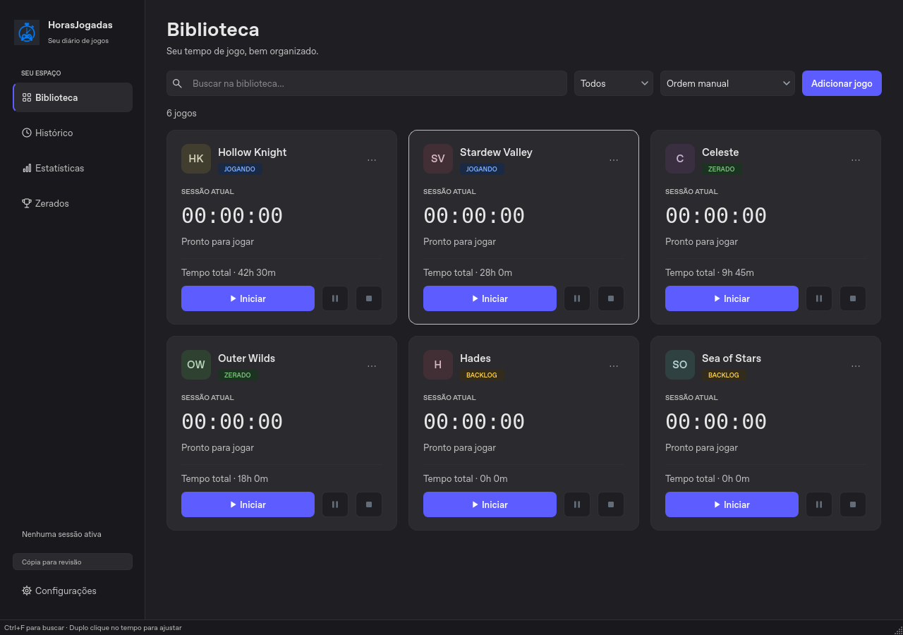

<div align="center">

# HorasJogadas

**Cada partida conta. Guarde a sua história.**

Cronômetros, biblioteca, histórico, estatísticas e jogos zerados. Interface em português e inglês, com dados no seu computador.

[**Baixar o aplicativo**](https://joaoppolli.github.io/HorasJogadas/) · [Todos os downloads](https://github.com/JoaoPPolli/HorasJogadas/releases/latest) · [Changelog](https://joaoppolli.github.io/HorasJogadas/changelog/) · [Guia de uso](docs/GUIA_DE_USO.md)

</div>



## Instalar

**Windows 10/11 de 64 bits:** [baixe o instalador](https://github.com/JoaoPPolli/HorasJogadas/releases/latest/download/HorasJogadas-Windows-Setup.exe), abra e siga as instruções. O app aparece no menu Iniciar. Não precisa instalar Python nem executar como administrador.

Prefere sem instalação? [Baixe o ZIP portátil](https://github.com/JoaoPPolli/HorasJogadas/releases/latest/download/HorasJogadas-Windows-Portable.zip), extraia **a pasta inteira** e abra `HorasJogadas.exe` dentro dela.

**Linux x86_64, Ubuntu 22.04 ou compatível:** [baixe o pacote](https://github.com/JoaoPPolli/HorasJogadas/releases/latest/download/HorasJogadas-Linux-x86_64.tar.gz), extraia e execute `./HorasJogadas` dentro da pasta extraída, em uma sessão gráfica. Não precisa de Python. Dependências de sistema estão no [guia de uso](docs/GUIA_DE_USO.md).

Ao abrir o pacote oficial no Linux, o app registra seu ícone e um atalho no menu de aplicativos do usuário, sem sudo. O lançador associa a janela ao ícone no X11 e no Wayland. Se mover a pasta do programa, abra o executável uma vez na nova localização para atualizar o atalho.

Os executáveis não possuem assinatura digital. O Windows pode exibir uma verificação ao abrir um download novo. Os arquivos oficiais estão nas Releases deste repositório; os [SHA-256](https://github.com/JoaoPPolli/HorasJogadas/releases/latest/download/SHA256SUMS.txt) permitem conferir a integridade.

## Já usava a versão anterior?

1. Feche o app antigo antes de abrir o novo.
2. Instale ou extraia a versão 3.10.0.
3. Abra o HorasJogadas: ele usa a **mesma pasta de dados**, sem precisar importar nada.

Antes de carregar registros existentes pela primeira vez, a nova versão cria uma cópia verificada de todos os arquivos de dados em uma pasta vizinha chamada `HorasJogadas-Backups-de-Versao`. Se essa cópia falhar, a abertura é interrompida. Não apague sua pasta de dados.

| Sistema | Dados oficiais |
| --- | --- |
| Windows | `%APPDATA%\HorasJogadas` |
| Linux | `~/HorasJogadas` |

As partidas feitas na **cópia para revisão** continuam separadas: elas não são mescladas automaticamente aos registros oficiais. O instalador e o desinstalador não removem os registros pessoais.

## O que há no app

- Biblioteca com busca, filtros, status e ordenação manual.
- Rolagem automática com o botão central: clique na roda sobre uma página ou lista e mova o mouse para cima ou para baixo. Quanto mais longe do ponto inicial, mais rápido; outro clique ou Esc para parar. Também permite segurar a roda, mover e soltar para encerrar.
- Cronômetros com pausa, recuperação de sessões e ajustes de tempo, inclusive valores negativos e atalhos de minutos.
- Histórico com edição e exportação CSV.
- Estatísticas com jogos ordenados pela sessão mais recente e gráfico dos cinco mais jogados.
- Zerados por ano e mês, campanhas, DLCs, novas jogadas, observações e horas adicionais de platina; importação e exportação TXT.
- Quatro temas: **Escuro minimalista**, **Original** (a paleta roxa da edição anterior), **Violeta** e **Claro**; barra de título nativa escura no Windows compatível.
- Português e inglês, backups completos, restauração e bloqueio para impedir duas instâncias de alterarem a mesma pasta.

## Controle pelo celular

Em **Configurações → Controle pelo celular**, selecione a rede do PC e clique em **Ativar controle pelo celular**. Escaneie o QR Code com a câmera do telefone. Como alternativa, abra o endereço mostrado e digite o código de seis dígitos; QR Code e código expiram em cinco minutos. Não precisa instalar um app no celular.

O painel reúne **Biblioteca, Histórico, Estatísticas, Zerados e Configurações**, com navegação adaptada ao celular e os temas e idiomas do app. Organize jogos, ajuste tempos, edite sessões, registre conclusões, consulte estatísticas, exporte CSV e importe ou exporte TXT. Em Configurações, altere as preferências do PC, gerencie capas, ícones e aparelhos lembrados, crie e baixe backups completos e confira os dados antes de restaurar. Também é possível verificar, baixar e confirmar a instalação de atualizações do aplicativo do PC.

O modo **Jogando agora** destaca o contador com botões grandes; favoritos deixam os jogos preferidos por perto. Os comandos usam os mesmos cronômetros e registros do computador; bloquear o telefone não interrompe a contagem. Formulários conferem se houve uma edição no PC antes de salvar. Depois de atualizar o aplicativo, recarregue a página do controle no celular.

O PC precisa permanecer **ligado, acordado e com o app aberto**, na mesma rede do celular. Use uma rede de confiança: o controle usa HTTP local, sem servidor na nuvem nem abertura de portas no roteador. Se houver várias interfaces de rede, escolha a do Wi-Fi ou cabo que conecta o PC ao celular. Confira o firewall em redes privadas se a página não abrir.

A conexão começa **desativada** a cada abertura do app. A opção **Lembrar este aparelho**, por até 30 dias, facilita a reconexão depois de ativar o controle no PC. O endereço usa uma porta estável; se o IP da rede mudar, escaneie novamente. Nas Configurações, remova acessos individualmente; **Novo código e desconectar aparelhos** revoga todos, inclusive os lembrados. Desativar a conexão não para os cronômetros. As credenciais temporárias ficam na memória; dos aparelhos lembrados, o PC guarda apenas hashes, fora dos backups e cópias de revisão. [Guia e solução de problemas](docs/GUIA_DE_USO.md#controle-pelo-celular).

### Com o PC desligado

Abra o [contador do celular](https://joaoppolli.github.io/HorasJogadas/celular/) uma vez com internet e adicione à tela inicial. Ele funciona offline, guarda a sessão ao bloquear ou recarregar o navegador e permite pausar, retomar, marcar favoritos e escolher a aparência. Este contador é independente do controle do PC.

Depois de jogar, **exporte as sessões** no celular e transfira o arquivo para o computador. Em **Configurações → Jogar com o PC desligado → Importar sessões do celular**, confira os horários e escolha os jogos de destino. A importação cria backup, preserva as sessões existentes e ignora registros já importados. Exportar não apaga a cópia do celular.

Você também pode exportar a biblioteca no PC ou no controle local e importá-la no contador offline para escolher seus jogos. Não é preciso conta nem nuvem. **Exporte uma cópia antes de limpar dados do navegador**, pois os registros offline ficam naquele aparelho.

## Capas opcionais

Em **Configurações**, marque **Exibir capas na biblioteca** e salve. A opção começa desativada: o visual compacto continua disponível e desligar as capas não apaga as imagens nem altera seus registros.

Em **Gerenciar capas**, clique em **Buscar capas dos jogos marcados**, confira os títulos sugeridos e escolha **Importar selecionadas**. A busca reúne Steam, GOG e Wikipedia, sem login ou chave de API. Você pode escolher todas as fontes ou uma só. Nomes com erros de digitação são comparados com títulos reconhecidos e pesquisados novamente; correspondências incertas e sequências parecidas precisam de seleção manual; você pode ajustar o texto da busca sem renomear o jogo.

As imagens de alta qualidade são baixadas de uma vez e ficam no computador, funcionando depois sem internet. Só os títulos pesquisados e suas tentativas de correção são enviados às fontes selecionadas, por sua iniciativa. Na busca em todas as fontes, a Wikipedia também ajuda a reconhecer os nomes. Jogos fora do catálogo podem usar uma imagem local. Os backups completos incluem as capas e a preferência de exibição.

## Ícones dos jogos

Em **Configurações → Gerenciar ícones**, busque em lote, confira a prévia e importe os ícones oficiais da Steam ou GOG. Você também pode clicar no quadrado das iniciais ou usar **Escolher ou trocar ícone** no menu do jogo. Uma imagem local é outra opção.

Os ícones substituem as iniciais e funcionam mesmo com capas desativadas. Em **Configurações → Exibir ícones dos jogos**, desmarque e salve para voltar às iniciais sem apagar as imagens. Jogos sem ícone continuam usando as iniciais. Capas e ícones são independentes, funcionam offline depois de importados e acompanham os backups completos. Não há busca automática de imagens ao abrir ou rolar a biblioteca.

## Atualizar

Abra **Configurações → Verificar atualizações**, baixe o pacote e escolha **Instalar e reiniciar**. O app confere o SHA-256 e cria um backup antes de fechar. No Windows, o instalador atualiza a pasta em uso; no Linux, o novo pacote passa por autoteste e a pasta anterior é preservada. A consulta automática de versões pode ser desativada nas Configurações. Não há instalação automática sem confirmação. No Linux, arquivos pessoais que estiverem junto do executável também são preservados, e a versão 3.1 recupera a base caso a atualização 3.0.1 tenha movido a pasta de dados junto do programa. A versão 3.2.1 corrige o ambiente herdado no Linux, confirma a abertura da nova janela e tenta reabrir a versão anterior se a nova encerrar antes de ficar pronta. O ciclo de atualização é testado também em Arch Linux. Erros ficam em `~/.cache/HorasJogadas/updates/v<versão>-<identificador>/update.log` (ou na pasta de cache configurada pelo sistema). A versão 3.0.0 precisa ser atualizada manualmente uma vez para receber esse recurso.

## Executar pelo código

Python 3.10 a 3.13, em uma sessão gráfica:

```bash
git clone https://github.com/JoaoPPolli/HorasJogadas.git
cd HorasJogadas
python -m venv .venv
# Windows: .venv\Scripts\activate
# Linux: source .venv/bin/activate
python -m pip install -r requirements-qt.txt
python app_qt.py
```

No Windows, `Iniciar.bat` prepara um ambiente `.venv_qt` e inicia a edição oficial. `IniciarNovaInterface.bat` continua disponível para abrir uma cópia isolada para revisão.

O lançador antigo `app.py` e o domínio `horas_jogadas/` foram preservados para compatibilidade. A interface oficial agora usa **PySide6/Qt**.

## Desenvolvimento

[Ambiente, testes e empacotamento](docs/DESENVOLVIMENTO.md) · [Modo de revisão](REVISAO_QT.md) · [Mudanças](CHANGELOG.md) · [Colaboração](COLABORACAO.md)

As capturas deste repositório e do site usam dados fictícios. Para relatar um problema, informe versão, sistema e passos para reproduzir, removendo dados pessoais dos anexos.

## Inicialização automática

Em **Configurações → Inicialização**, escolha **Abrir HorasJogadas ao entrar no computador** e/ou **Ativar controle pelo celular ao abrir o app** e clique em **Salvar**. As opções começam desativadas e valem para a edição oficial. O início com o sistema vale para o usuário atual no Windows e Linux, sem administrador; desmarque e salve para remover. Mantenha a pasta do programa no mesmo lugar.

O controle usa a última rede escolhida quando disponível, ou outra rede local ativa. Se a rede ainda estiver iniciando, tenta novamente por até um minuto. Celulares lembrados podem reconectar; aparelhos novos precisam parear. O PC precisa estar ligado e acordado. As mesmas opções estão nas Configurações do painel conectado.

## Widget para OBS

Em **Configurações → Widget para OBS**, marque **Ativar widget do OBS neste computador**, escolha o jogo, o tempo exibido e a aparência, e clique em **Salvar**. **Seguir o cronômetro em execução** acompanha o último jogo iniciado ou retomado; você também pode fixar um jogo. Escolha entre sessão atual e tempo total (histórico mais a sessão aberta).

Clique em **Copiar link para o OBS**. No OBS Studio, adicione **Fontes → + → Navegador**, cole o link e configure **600 × 180** pixels, ou **600 × 240** com o nome do jogo. Preserve o CSS padrão do OBS para o fundo transparente. A opção **Abrir prévia** mostra o resultado no navegador. Ajuste o tamanho da fonte na cena do OBS.

O padrão é branco e Minimalista. Arcade e Digital são alternativas; todos aceitam cor no formato `#RRGGBB`. As alterações aparecem sem recadastrar a fonte. O timer pausa e retoma junto com o app, sem reiniciar horas ao completar um dia. Se o app fechar ou a conexão falhar, o widget fica oculto em poucos segundos e volta ao reconectar.

O app e o OBS devem estar **no mesmo computador**, Windows ou Linux. A conexão é local e somente de leitura, sem controle de gravação ou transmissão. Não depende do controle pelo celular. O link continua válido ao reabrir o app; quando habilitado, o widget inicia junto com a edição oficial. A cópia de revisão só ativa o widget manualmente. A chave local não é exportada nos backups.

## Calcular a platina adicional

Em **Zerados → Editar**, confira a **Duração** de quando zerou, escolha o **Contador do jogo** correspondente e clique em **Usar tempo extra**. Com 16h ao zerar e 20h35 no contador, a prévia preenche 4h35 em **Platina adicional**. O total inclui a sessão aberta. Clicar novamente substitui o valor pela diferença atual, sem duplicar horas. Clique em **Salvar** para confirmar ou **Cancelar** para descartar.

Ao terminar os troféus, marque **Platina concluída** e salve. O botão de cálculo fica bloqueado, preservando o tempo da platina se você jogar mais depois. Você pode corrigir o valor manualmente ou desmarcar a opção para recalcular. A função também está no controle conectado pelo celular.

Se houver várias conclusões do mesmo contador, informe o extra manualmente para não misturar campanhas. Confira o contador e a duração se o total for menor que o tempo ao zerar; o valor existente permanece preservado. Os metadados de vínculo e platina concluída acompanham os backups completos; a exportação TXT continua no formato de tempos já existente.

## Retrospectiva e página do jogo

Em **Estatísticas → Retrospectiva**, escolha o ano e o mês (ou **Ano inteiro**), confira a prévia e use **Salvar imagem PNG**. A imagem tem 1080 × 1350 pixels e segue o tema e idioma do app. Ela contém jogos e tempos pessoais: confira a prévia antes de compartilhar. A exportação acontece no seu dispositivo, sem envio automático. Somente sessões salvas entram nas horas; conclusões são contadas separadamente, sem somar novamente duração de campanha ou platina. Sessões que atravessam meses e anos são distribuídas conforme os dias registrados.

Na biblioteca, clique no nome do jogo ou use **Mais ações → Página do jogo**. A página reúne o timer, tempo salvo, sessões, média, primeira/última partida e conclusões com platina e observações. Mostra as últimas 100 sessões; o histórico completo continua disponível em Histórico. No PC, duplo clique numa sessão abre sua edição.

Na **Página do jogo → Retrospectiva do jogo**, a imagem contém somente as sessões salvas daquele jogo no período escolhido: tempo, sessões, dias jogados, média e maior sessão, além da evolução por mês ou por dia. A primeira e a última data também se referem ao período. O nome do jogo aparece na imagem e no arquivo PNG. A retrospectiva geral continua em Estatísticas.

Em **Zerados → Retrospectiva**, a imagem usa somente os registros dessa lista, mesmo sem biblioteca ou histórico de sessões. Ela abre no ano selecionado na página e permite escolher um mês ou o ano inteiro. Mostra jogos zerados, DLCs, experiências, platinas marcadas como concluídas, tempo registrado e os registros mais recentes. O resumo anual inclui um gráfico de jogos e DLCs concluídos por mês. Os tempos base e de platina adicional aparecem separados, e o total inclui ambos uma única vez, como na página Zerados. Durações e dias desconhecidos continuam indicados; cada nova jogada conta como um registro. A data considerada é a do registro na lista, inclusive para as platinas vinculadas a ele.

As três retrospectivas também estão no controle conectado pelo celular, com prévia e download do PNG nas respectivas páginas.

## Detecção automática de jogos

Na página do jogo ou em **Configurações → Detecção automática de jogos**, escolha **Configurar detecção**. Selecione o executável real do jogo, marque **Detectar este jogo automaticamente** e salve. Não selecione Steam, outro launcher ou o próprio HorasJogadas. O modo **Caminho exato** é o recomendado para Windows e jogos Linux nativos. No Wine/Proton, o modo **Nome do executável** oferece uma alternativa; use um nome específico para evitar ambiguidades. Nem todo launcher ou ambiente restringido permite identificar o processo; nesses casos, use o contador manual.

O HorasJogadas precisa ficar aberto. A consulta ocorre em segundo plano a cada 2 segundos; o fechamento é confirmado em duas verificações. A contagem começa quando o processo é observado, sem inventar tempo anterior à abertura do app. Vários processos do mesmo jogo pertencem à mesma sessão; ela só é salva quando todos fecham.

A detecção só encerra contadores que ela mesma iniciou. Pausar ou encerrar manualmente impede um novo início enquanto o mesmo jogo continuar aberto. Ajustes de tempo continuam sendo incluídos no salvamento automático. Sessões já abertas ou pausadas não são sobrescritas. Ao desativar a detecção, o contador atual continua disponível para controle manual.

O controle geral nas Configurações permite suspender a detecção sem esquecer os vínculos. No celular, você pode ativar/desativar um vínculo já configurado; a seleção do executável é feita no PC. Nenhuma lista de processos é enviada à rede ou salva em relatórios. A função começa desativada e cópias de revisão nunca iniciam a consulta automaticamente.

## Rolagem e seletores

A roda do mouse rola o conteúdo sem trocar o valor de seletores, anos, datas ou campos numéricos. Com a lista aberta, a roda navega pelas opções; clique para confirmar. Botões, digitação e navegação por teclado continuam disponíveis. Na página do jogo, o banner preserva a proporção da imagem e mostra a arte inteira, inclusive em janelas largas.
