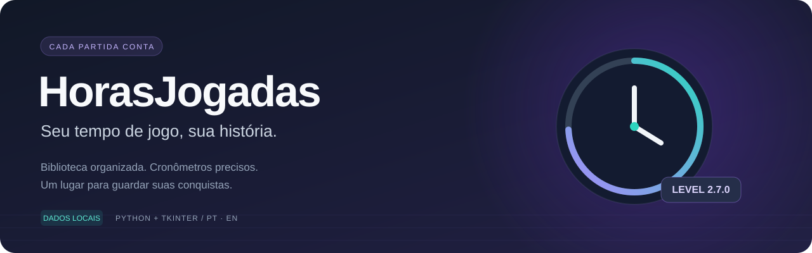
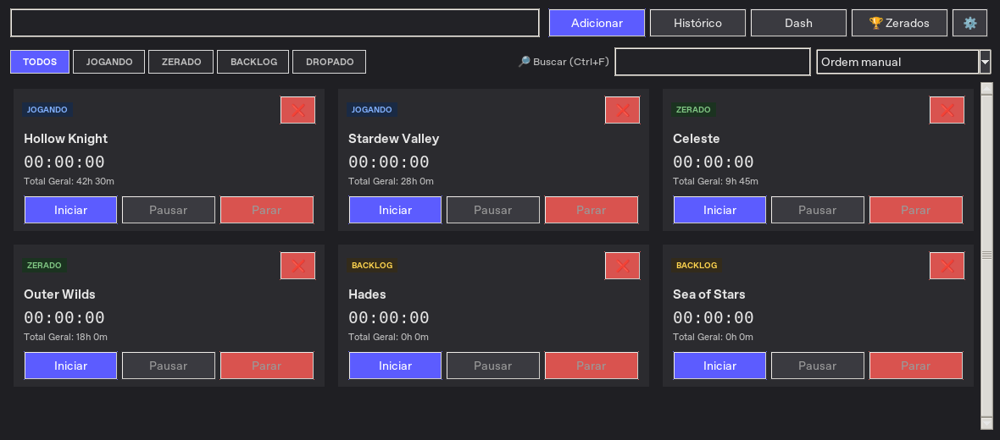
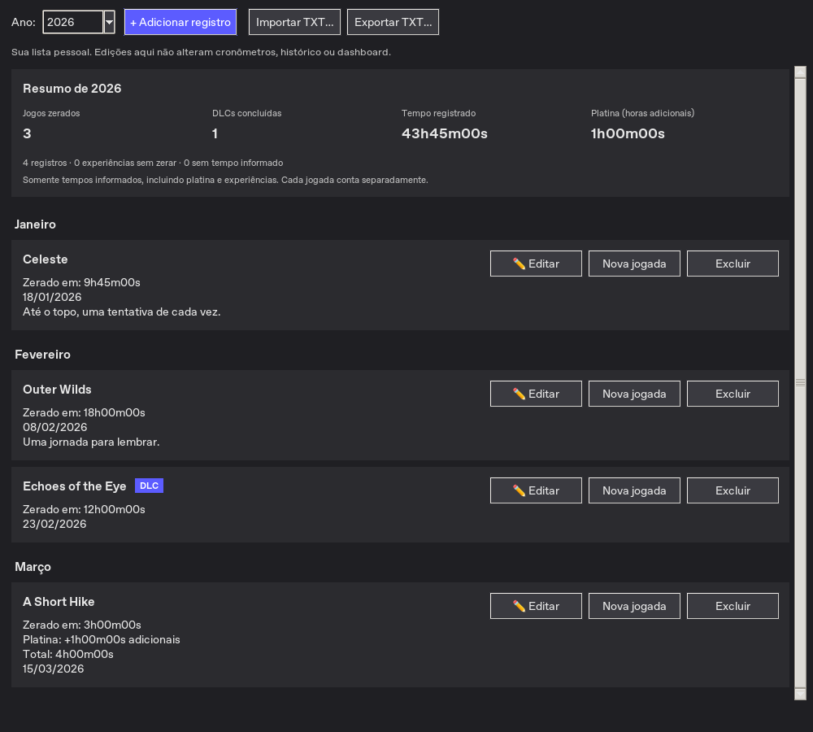

<div align="center">



**Cronometre suas partidas. Organize sua biblioteca. Celebre cada jogo zerado.**

Um aplicativo desktop em Python e Tkinter, com dados locais e interface em português e inglês.


[Começar](#-comece-a-jogar) · [Recursos](#-o-que-você-pode-fazer) · [Guia de uso](docs/GUIA_DE_USO.md) · [Desenvolvimento](docs/DESENVOLVIMENTO.md) · [Novidades](CHANGELOG.md)

</div>

## 🎮 O que você pode fazer

| Recurso | Como ajuda no dia a dia |
| --- | --- |
| **Biblioteca de jogos** | Organize os títulos em Jogando, Zerado, Backlog e Dropado. Busque, filtre e ordene seus cartões. |
| **Cronômetros por jogo** | Inicie, pause e encerre sessões; ajuste o tempo quando precisar. |
| **Histórico e dashboard** | Consulte sessões, veja estatísticas e corrija registros esquecidos. |
| **Zerados por ano** | Registre campanhas, novas jogadas, DLCs, experiências e horas adicionais de platina. |
| **Resumo anual** | Veja jogos e DLCs concluídos, tempo registrado e horas extras de platina. |
| **Importação e exportação** | Leve histórico e resumo para CSV; importe e exporte Zerados em TXT. |
| **Proteção dos dados** | Escrita atômica, backups, recuperação de sessões e bloqueio de instância duplicada. |
| **Português e inglês** | Troque o idioma nas configurações sem reiniciar o aplicativo. |

## ✨ Conheça a interface

### Sua biblioteca, pronta para a próxima partida



### Um lugar para guardar cada conquista



*Capturas da versão 2.7.0 em Linux, com dados fictícios. Fontes, ícones e bordas podem variar no Windows.*

## 🚀 Comece a jogar

### Executar com Python

Você precisa de **Python 3.10 ou superior com Tkinter**. O app usa somente a biblioteca padrão do Python.

```bash
git clone https://github.com/JoaoPPolli/HorasJogadas.git
cd HorasJogadas
python app.py
```

No Windows, instale o Python com suporte a Tcl/Tk e marque **Add Python to PATH**. Depois, também é possível abrir `Iniciar.bat`.

No Debian/Ubuntu, caso o Python do sistema não tenha Tkinter:

```bash
sudo apt-get install python3-tk
python3 app.py
```

> O app precisa de uma sessão gráfica. Para validar em Linux sem tela, use Xvfb; veja o [guia de desenvolvimento](docs/DESENVOLVIMENTO.md#linux-sem-interface-gráfica).

### Gerar seu executável no Windows

Com o Python instalado, dê dois cliques em **`build_exe.bat`**. O script instala o PyInstaller e cria `HorasJogadas.exe` na pasta do projeto. Mantenha a pasta `horas_jogadas/` ao lado desse executável.

Para gerar um pacote de distribuição independente do Python, consulte [Empacotamento](docs/DESENVOLVIMENTO.md#empacotamento-no-windows). O executável não é versionado neste repositório.

### Sua primeira sessão

1. Digite o nome de um jogo e clique em **Adicionar**.
2. No cartão, clique em **Iniciar**. Use **Pausar** quando precisar.
3. Clique em **Parar** para gravar a sessão no histórico.
4. Consulte **Histórico**, **Dash** e **🏆 Zerados** para acompanhar sua jornada.

## 🏆 Novidades da versão 2.7.0

- **Resumo anual em Zerados:** jogos, DLCs, tempo registrado e horas adicionais de platina.
- **Etiqueta de DLC/expansão:** definida ao adicionar ou editar uma conclusão e preservada no TXT.
- **Busca mais confortável:** clicar fora libera o teclado sem apagar o filtro; `Esc` limpa e sai do campo; `Ctrl+F` volta à busca.

O resumo soma tempos informados na Lista de Zerados, incluindo experiências e extras de platina. Cada jogada conta separadamente. Tempos desconhecidos são indicados e não viram horas inventadas.

Veja o [histórico de mudanças](CHANGELOG.md) e o [guia completo de Zerados](docs/GUIA_DE_USO.md#zerados-por-ano).

## 💾 Seus dados ficam com você

| Sistema | Pasta padrão |
| --- | --- |
| Windows | `%APPDATA%\HorasJogadas` |
| Linux e macOS | `~/HorasJogadas` |

O app guarda os dados localmente, sem conta ou serviço externo. A pasta de dados é separada da pasta do aplicativo. Atualizar o código não apaga o histórico.

**Importante:** a Lista de Zerados tem arquivo e recuperação próprios (`zerados.json`). O restaurador de backups de jogos/histórico não restaura essa lista. Para uma cópia completa, feche o app e copie toda a pasta de dados. Também é possível exportar cada ano em TXT.

Consulte [dados, backups e recuperação](docs/GUIA_DE_USO.md#dados-backups-e-recuperação) antes de mover ou restaurar seus arquivos.

## 🔄 Atualizações

Na edição com código ao lado do lançador, abra **Configurações → Atualizar app…** e selecione o ZIP de atualização. O app valida o pacote, guarda a versão anterior e reinicia. O pacote para distribuição tem um fluxo próprio; [veja os detalhes](docs/GUIA_DE_USO.md#atualizar-o-aplicativo).

## 🛠️ Para quem desenvolve

```bash
python -m unittest discover -s tests -t .
```

O pytest é opcional:

```bash
python -m pip install -r requirements-dev.txt
python -m pytest
```

- [Guia de desenvolvimento](docs/DESENVOLVIMENTO.md): ambiente, estrutura, testes e empacotamento.
- [Guia de colaboração](COLABORACAO.md): branches, commits e revisão.
- [Instruções do projeto](AGENTS.md): compatibilidade, dados e cuidados com o atualizador.

Para relatar um problema, informe a versão, o sistema operacional e os passos para reproduzir. Revise os logs antes de compartilhá-los para remover informações pessoais.
