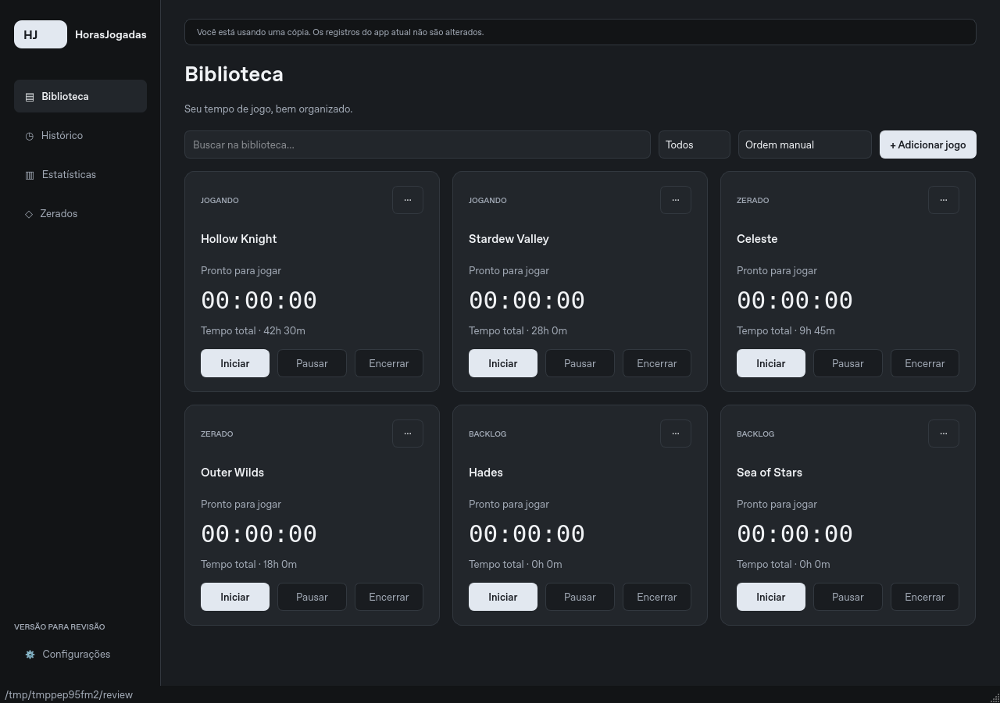

# HorasJogadas — nova interface para revisão

**Escuro minimalista · Python + PySide6 · sem publicação no GitHub**

Esta versão é separada do aplicativo atual. Extraia o pacote em **uma pasta nova** e use exclusivamente `IniciarNovaInterface.bat` para avaliar a interface Qt. Não copie os arquivos por cima da instalação atual.



## Abrir no Windows

1. Tenha **Python 3.10 a 3.13, de 64 bits**, com a opção **Add Python to PATH**. O pacote de revisão contém código-fonte, não um executável Windows pronto.
2. Extraia a pasta inteira em um local novo.
3. **Feche o aplicativo atual antes da primeira cópia**, para incluir seus registros mais recentes.
4. Execute **`IniciarNovaInterface.bat`**. Na primeira abertura, ele cria `.venv_qt` e instala o PySide6 pelo PyPI; precisa de internet nessa etapa.
5. A interface abre uma cópia independente dos dados. O app atual continua disponível pelo lançador que você já utiliza.

Para experimentar só o visual com dados fictícios:

```powershell
IniciarNovaInterface.bat --demo
```

O modo de demonstração é temporário: alterações nele desaparecem ao fechar. Para testar com seus registros, abra sem `--demo`.

## Onde ficam os arquivos

| Conteúdo | Pasta padrão no Windows |
| --- | --- |
| Dados oficiais do app atual | `%APPDATA%\HorasJogadas` |
| Cópia de revisão Qt | `%APPDATA%\HorasJogadas-Revisao-Qt` |

No Linux/macOS, ficam respectivamente em `~/HorasJogadas` e `~/HorasJogadas-Revisao-Qt`.

A primeira execução copia os arquivos para a pasta de revisão e compara seus hashes SHA-256. Se a origem mudar durante a cópia, a operação é cancelada. Uma revisão existente é reutilizada; **não é sobrescrita nem sincronizada automaticamente**.

**As sessões novas que você registrar na revisão ficam só nessa cópia.** Durante a avaliação, continue usando o aplicativo atual para seus registros oficiais. Não há mesclagem automática entre as duas versões. A adoção definitiva e o tratamento dessas diferenças devem acontecer somente após a aprovação.

O programa recusa usar como revisão a própria pasta de origem, uma subpasta dela ou uma pasta existente sem identificação de revisão. A trava de instância e os logs ficam na cópia. Nenhum teste precisa abrir ou alterar os dados oficiais.

Se seus arquivos ficam em outro local:

```powershell
IniciarNovaInterface.bat --source "D:\Meus dados\HorasJogadas"
```

Para uma segunda avaliação com uma cópia atualizada, escolha **um destino novo**:

```powershell
IniciarNovaInterface.bat --source "%APPDATA%\HorasJogadas" --review-dir "%APPDATA%\HorasJogadas-Revisao-Qt-2"
```

As configurações também oferecem **Criar revisão de outra pasta…**. Isso cria outra cópia e informa como abri-la, sem trocar os dados da janela atual.

## O que está disponível

- Biblioteca com busca, filtros, ordenação, renomeação, status, exclusão de cartões e ordem manual.
- Cronômetros com iniciar, pausar, retomar, encerrar, ajuste de tempo e contagem total ou parcial da pausa.
- Distribuição do tempo entre dias, recuperação após fechamento inesperado e confirmação ao sair com sessões abertas.
- Histórico com edição, inclusão manual, exclusão, desfazer e exportação CSV.
- Estatísticas, sequência de dias, períodos do gráfico, totais e exclusão do histórico de um jogo.
- Zerados por ano, resumo anual, DLCs, platina adicional, experiências, notas, novas jogadas, edição, exclusão e desfazer.
- Importação TXT com prévia, seleção e correção; exportação TXT com os metadados existentes.
- Idiomas português/inglês e três paletas; a inicial é **Escuro minimalista**, conforme escolhido.
- Backups completos, restauração e acesso aos backups de jogos/histórico da versão atual copiados para a revisão.
- Reutilização da implementação do selo da barra de tarefas e de instância única. O selo ainda precisa ser conferido no Windows.

O formato dos JSON e os IDs dos registros são reutilizados da versão atual. A lógica de persistência, estatísticas, CSV, TXT e validação de sessões é compartilhada com ela.

## Backups e recuperação

Em **Configurações → Criar backup completo**, a revisão guarda jogos, sessões, Zerados, configuração e sessões abertas em `full-backups/`. A restauração confere os hashes e cria outra cópia completa antes de substituir os arquivos da **revisão**.

Os backups antigos de jogos/histórico continuam disponíveis na opção separada **Restaurar backup do app atual**. Como antes, eles não incluem a Lista de Zerados.

Operações com vários arquivos criam um diário de recuperação na cópia. Se uma gravação falhar, o estado anterior é restaurado; se houver interrupção, o lançador tenta recuperar esse diário antes de carregar a interface. Não apague arquivos de recuperação manualmente em caso de erro.

Antes de uma migração definitiva, mantenha também uma cópia externa da pasta completa dos dados oficiais, feita com o aplicativo fechado. Esta entrega **não executa a migração definitiva**.

## Roteiro para sua aprovação

1. Abra o app atual, confira quantidades e alguns registros antigos e feche-o.
2. Abra a revisão. Confira os mesmos jogos, sessões, datas, horas, Zerados, DLCs e notas.
3. Role listas, abra menus e redimensione a janela. Confira também a escala do Windows que você usa.
4. Em um jogo de teste, inicie, pause, retome e encerre uma sessão; feche e reabra a revisão e confira o histórico.
5. Teste uma edição e uma exclusão seguida de **Desfazer**.
6. Exporte um ano em TXT e reimporte; confira a preservação de dados e a prevenção de duplicatas.
7. Crie um backup completo, altere um registro de teste e restaure esse backup na revisão.
8. Abra novamente o app atual e confira que seus dados oficiais permaneceram iguais.
9. Informe os ajustes desejados. **Nenhuma publicação ou substituição será feita sem sua aprovação.**

## Validação realizada e limites

- **99 testes existentes:** passaram; código do aplicativo Tkinter preservado.
- **34 testes novos:** passaram; incluem compatibilidade dos arquivos, isolamento da origem, rollback de gravação, recuperação, virada de dia, TXT, CSV, backups, botões, diálogos, idiomas e temas.
- Janela nativa Qt/X11 em Linux: abertura das cinco telas, cronômetro real, rolagem e redimensionamento verificados.
- Capturas nesta pasta usam exclusivamente dados fictícios.

**Ainda não validado em Windows:** executável, instalador, escala e fontes específicas, SmartScreen e selo da barra de tarefas. O teste local não substitui sua revisão no sistema em que você usa o aplicativo.

O atualizador por ZIP e a restauração de versões de código permanecem no aplicativo atual. A revisão Qt não instala atualizações nem substitui código: a estratégia de distribuição e atualização definitiva fica pendente da aprovação. Os botões de backup desta versão tratam os **dados da cópia**, não os arquivos do programa.

## Desenvolvimento

```bash
python -m venv .venv_qt
# Ative o ambiente conforme seu sistema.
python -m pip install -r requirements-qt.txt
python app_qt.py --demo
python -m unittest discover -s tests -t .
```

Testes Qt sem tela no Linux:

```bash
QT_QPA_PLATFORM=offscreen python -m unittest discover -s tests_qt -t .
```

O aplicativo original continua em `app.py` e `horas_jogadas/`. A interface nova está em `app_qt.py` e `horas_jogadas_qt/`. Não é necessário alterar o lançador nem refazer o executável do app atual para experimentar a revisão.
